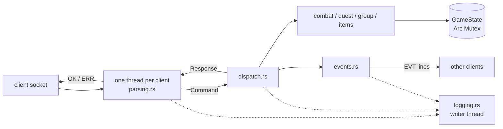
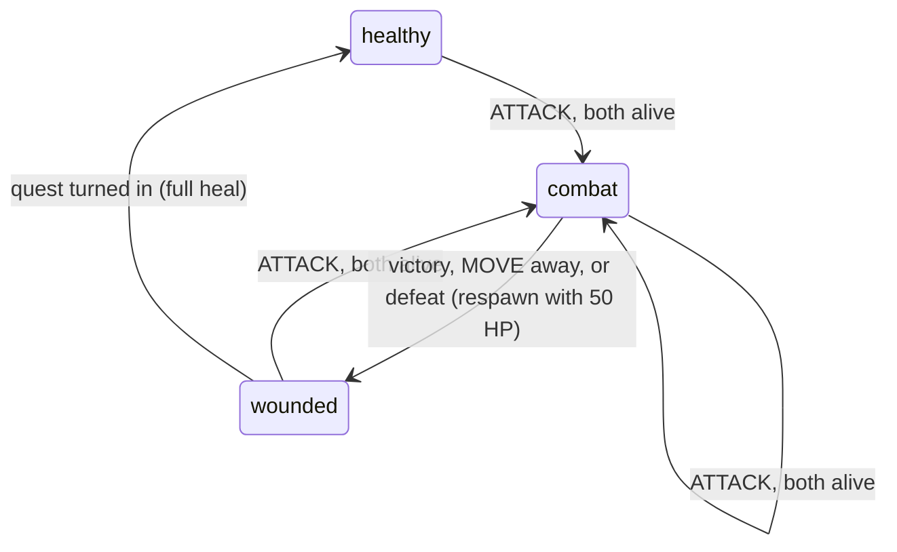
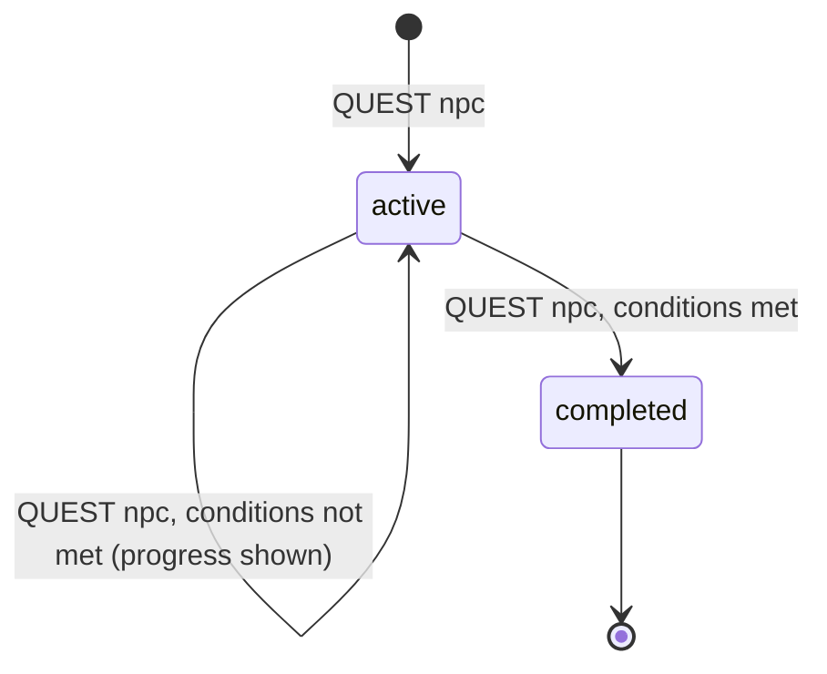
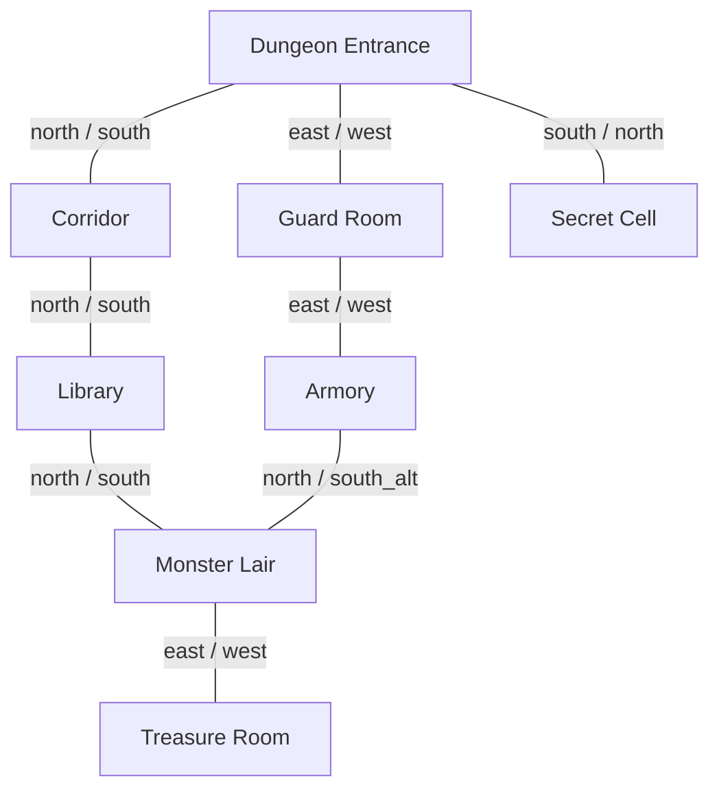

*This project has been created as part of the 42 curriculum by jferone, slidriss, srezzaq.*

# TAP - The Answer Protocol

## Description

TAP is a shared-world text adventure played over TCP. Several players
connect to one server, explore a small dungeon, talk to NPCs, pick up
items, fight a monster and complete quests together. Everything follows
RFC 42TAP: one UTF-8 line per message, commands from the client, `OK` or
`ERR` replies and asynchronous `EVT` events from the server.

The goal of a game: defeat the monster and take its treasure.

The repository holds three Rust programs:

| Program | Path | Role |
|---|---|---|
| Server | `tap_project/tap_server` | world state, rules, protocol, logs |
| CLI client | `tap_project/tap_client` | type protocol commands, see every line live |
| GUI client | `tap_project/tap_gui` | egui window: room, inventory, buttons, chat |

## Instructions

Requirements: a Rust toolchain (`rustup`, edition 2024, with `clippy` and
`rustfmt`) and `make`. The GUI needs the usual X11 or Wayland libraries of
a Linux desktop.

```sh
make install         # fetch the dependencies of the three crates
make run-server      # terminal 1: server on 127.0.0.1:7878
make run-client      # terminal 2: CLI client
make run-client-gui  # terminal 3: GUI client
```

Details in [Building and Running](#building-and-running).

## Architecture



- **Concurrency model**: one OS thread per connection, all sharing one
  `GameState` behind an `Arc<Mutex<...>>`. A command takes the lock once,
  changes the world and sends its events, then releases it. Commands are
  therefore applied one at a time, in arrival order, which is also the
  turn order of combat. The world is small, so one lock is simpler than
  fine-grained locking and cannot deadlock.
- **Dispatcher, not inline handling**: `parsing.rs` turns a line into a
  typed `enum Command`; `dispatch.rs` has one arm per command and returns a
  `Response` (`Ok(body)` or `Err { code, message }`). Game rules live in
  their own modules (`combat.rs`, `quest.rs`, `group.rs`, `items.rs`),
  each owning one part of the state and tested without any socket.
- **Events**: `events.rs` writes every `EVT` line to the streams kept in
  `GameState.senders`, while the lock is held, so two events never
  interleave on one socket. A stream that fails to write is skipped: its
  own thread sees the broken connection and cleans up.
- **Disconnection**: `QUIT`, end of stream and read errors all run the
  same cleanup: leave the group, leave the room, drop the stream, update
  the player count, each step sending its event.
- **Startup**: `world_check.rs` validates `world.yaml` (subject minimums,
  exits, references, one connected map with a loop) and refuses to start on a broken world, listing every
  problem at once.

## Protocol Implementation

The server follows RFC 42TAP. Where the RFC is silent or inconsistent, the
choices below were made.

| Topic | RFC | Our choice | Why |
|---|---|---|---|
| Combat broadcast | no event defined | `EVT ROOM COMBAT <user> <npc-id> damage=<n> target_hp=<n> status=<s>` to the others in the room | the subject asks combat results to reach the players around; `key=value` data as in `EVT STATS players=<n>` |
| Event syntax | 4.1 ABNF: `event-type = 1*ALPHA`; 7.1 tables: `EVT <category> <type> <data>` | the 7.1 tables (`EVT ROOM PRESENCE ENTER bob`) | the tables define every event; the ABNF is too narrow for them |
| Own events | silent | an event never goes back to the player who caused it | that player already has the `OK` reply |
| `EVT GROUP INVITE` | `<leader>` | the leader of the inviting group, whoever invited | it is the name `GROUP JOIN` expects |
| Unknown command, wrong arguments | no code | `ERR 401 Unknown command`, `ERR 401 Invalid number of arguments for <CMD>` | 4xx is non-fatal for every client (RFC 7.3) |
| Command before `CONNECT` | no code | `ERR 404 Try with first CONNECTED` | same reason |
| Second `CONNECT` | no code | `ERR 401 <name> already connected, use QUIT first` | same reason |
| Line over 1024 bytes | 9.4 recommends a limit | `ERR 401 LINE_TOO_LONG` | RFC 9.4 |
| Control character in a chat message | 9.2: reject or neutralise | `ERR 401 INVALID_MESSAGE` | relayed as is, an escape sequence would drive other players' terminals |
| Fixed item (`obtainable: false`) | no code | `ERR 403 ITEM_NOT_OBTAINABLE` | the item stays visible in its room |
| `GROUP JOIN` without invitation | no code | `ERR 403 NOT_INVITED` | joining needs an invitation to that group |
| `GROUP INVITE` of an unknown player | no code | `ERR 404 PLAYER_NOT_FOUND` | same family as the other 404 lookups |
| Identifiers | examples use `loc.`, `item.`, `npc.` prefixes | bare ids from `world.yaml` (`cell_key`, `monster`) | the RFC shows the prefixes in examples only; every reply uses the same ids as LOOK |
| `QUEST` reply status | example shows `available` | first `QUEST` accepts at once: `active` | one command both accepts and turns in, see [Quest System](#quest-system) |

## Combat System

One `ATTACK <npc>` is one full round: the player strikes, then the NPC
strikes back if it is still standing.

| Rule | Value |
|---|---|
| Player health | 100 HP at start, never above 100 |
| Player damage | 5, plus 10 with the `sword` in the inventory |
| NPC counter-attack | its `attack` stat in `world.yaml` (5 if missing) |
| Monster | 20 HP, attack 12 |
| Initiative | the attacker always strikes first; there is no roll |
| Turn order | arrival order of commands, serialised by the world lock |
| Who can be attacked | NPCs marked `hostile: true` only, else `ERR 405 NPC_NOT_HOSTILE` |
| NPC health | shared by every player: two players hitting the monster add up |
| NPC death | the kill goes to the player who lands the last hit; the NPC rises again at full health at once, so every player can finish the treasure quest |
| Player death | at 0 HP the player respawns at the entrance with 50 HP |

Combat states, as reported by `STATUS` and `ATTACK`:



`STATUS` answers `healthy` (full HP), `wounded` (below 100 HP) or `combat`
(the last round left both sides standing). Leaving the room ends a fight:
`MOVE` is the way to flee, so no `FLEE` command is needed. There is no
`DEFEND`, critical hit or status effect: with one enemy and four items,
the sword is the one tactical choice. With it the monster falls in two
rounds and the player takes 12 damage; bare-handed it takes four rounds
and 36 damage.

Every round is broadcast to the room as `EVT ROOM COMBAT`.

## Quest System

A quest is given by one NPC (`giver`) and is done when its conditions
hold: an item in the inventory (`requires_item`), an NPC beaten
(`requires_kill`), or both. The server checks them, never the client.



- **Progression**: conditions are read from the player's state when asked,
  so nothing can drift: `QUESTS` shows `progress: "met/needed"` for each
  active quest.
- **Completion**: manual, by asking the giver again with the same `QUEST
  <npc>`. One command accepts and turns in, so no `COMPLETE_QUEST` is
  needed; there is no `ABANDON_QUEST` either, a quest never blocks another.
- **Rewards**: turning in a quest fully heals the player. A quest never
  hands out an item: items are unique in the world.
- **Dependencies**: none between the two quests; the treasure quest needs
  the monster beaten and the treasure taken, in any order.
- **When nothing is left**: `ERR 406 NO_QUEST_AVAILABLE`.

| Quest | Giver | Conditions |
|---|---|---|
| `free_prisoner` - Free the Prisoner | prisoner (secret cell) | hold the `cell_key` |
| `treasure_quest` - The Treasure | merchant (entrance) | beat the `monster`, hold the `treasure` |

## World Design

<!-- review: slidriss -->

Eight rooms: a loop of six, plus two dead ends. Room pictures for the
GUI are in `tap_project/tap_client/assets`.



| Room | NPC | Item |
|---|---|---|
| Dungeon Entrance | merchant (dialogue, quest giver) | |
| Corridor | | torch (fixed) |
| Guard Room | | cell key |
| Library | | shield (fixed) |
| Armory | | sword |
| Monster Lair | monster (enemy) | |
| Treasure Room | | treasure |
| Secret Cell | prisoner (dialogue, quest giver) | |

- NPC roles: the merchant gives advice and the treasure quest, the
  prisoner gives the rescue quest, the monster is the one enemy.
- Items: five, three of them obtainable (sword, cell key, treasure); the
  torch and the shield are scenery that LOOK shows but TAKE refuses.
- The loop entrance - corridor - library - monster lair - armory - guard
  room - entrance lets players reach the monster by two paths.

## Server Logging

Every log line is one JSON object (JSON Lines), written to the console and
appended to `tap_project/tap_server/logs/server.jsonl`:

```json
{"ts":"2026-10-22T14:23:20.512Z","level":"INFO","event":"item_taken","arg":"Cell Key","player":"alice","result":"taken=cell_key"}
```

`ts` (UTC, milliseconds), `level` and `event` always come first. Lines go
through a channel to one writer thread, so a slow disk never holds a
client thread or the world lock.

| Level | Events |
|---|---|
| INFO | `server_start`, `connection_open`, `connection_close` (with `reason`: quit, eof, reset, write_failed, read_error), `command` (every line received), `reply` (every `OK` sent) |
| INFO | world changes: `player_joined`, `player_moved`, `item_taken`, `item_dropped`, `npc_talk`, `combat_round`, `quest_update`, `quest_completed`, `group_created`, `group_invite`, `group_joined`, `group_left`, `chat_global`, `chat_room`, `chat_group` |
| WARN | `reply` for every `ERR` sent; abuse: `abuse_command_flood` (over 20 commands in 1 s on one connection), `abuse_rapid_connections` (over 10 connections in 10 s from one IP), `abuse_oversized_line`; `log_file_unavailable` |
| ERROR | `read_error`, `accept_failed` |

Connection lines carry `ip` as `address:port`, which identifies one
connection; `command` and `reply` lines also carry `player` once known.
An abuse burst is logged once, not once per command. Abuse is logged, not
blocked.

Monitoring with `jq`:

```sh
tail -f tap_project/tap_server/logs/server.jsonl | jq -c 'select(.level != "INFO")'   # problems only
jq -c 'select(.event | startswith("abuse_"))' tap_project/tap_server/logs/server.jsonl # abuse
jq -c 'select(.player == "alice")' tap_project/tap_server/logs/server.jsonl            # one player
```

## Group Contributions

<!-- review: each member checks their own line -->

| Member | Responsibilities |
|---|---|
| slidriss | TCP server and multi-client threads, command parsing into `Command`, dispatcher, greeting, case-insensitive commands, RFC error codes, player streams for broadcast, disconnection, pipelined commands fix, LOOK JSON, world data and room pictures |
| srezzaq | CLI client, GUI client (egui: room view, inventory, action buttons, counters, NPC dialogue, health bar, quests, chat view) |
| jferone | game engine: combat, quests, groups, items, world validation, WHO; CHAT and every `EVT`; server logging; RFC conformance fixes; Makefile; README assembly |

## Building and Running

The root `Makefile` drives `cargo` in the three crates:

| Target | Effect |
|---|---|
| `make install` | fetch every dependency (`cargo fetch`) |
| `make build` | build the three programs |
| `make run-server` | start the server on `127.0.0.1:7878`, from `tap_project/tap_server` where `data/world.yaml` and `logs/` live |
| `make run-client` | start the CLI client; `make run-client HOST=10.0.0.5 PORT=7878` for another server |
| `make run-client-gui` | start the GUI client; same `HOST` and `PORT` |
| `make test` | run every unit test |
| `make lint` | `cargo fmt --check`, then `cargo clippy` with warnings as errors |
| `make format` | format the three crates |
| `make clean` | remove build outputs and server logs |

Without `make`: `cd tap_project/tap_server && cargo run`, and
`cargo run -- [host] [port]` in `tap_client` or `tap_gui`.

**CLI client** <!-- review: srezzaq -->: commands are typed exactly as the
protocol spells them (`MOVE north`, `CHAT ROOM hello`). A reader thread
prints every server line as it arrives, so events show up while the
player is typing.

**GUI client** <!-- review: srezzaq -->: enter a name and press Connect;
the room, the inventory and the actions are buttons; the log and the
chat are shown apart.

## Testing

**Unit tests**: `make test`. The server tests cover every command module
without sockets, events with real local sockets, and random campaigns of
thousands of actions that check world invariants after each step (the
heaviest are `#[ignore]`: `cargo test --release -- --ignored` in
`tap_project/tap_server`).

**Multiplayer**: start the server, then two clients (CLI, GUI or
`nc 127.0.0.1 7878`):

| Client A | Client B sees |
|---|---|
| `CONNECT alice` | `EVT ROOM PRESENCE ENTER alice`, `EVT STATS players=2` |
| `CHAT GLOBAL hi` | `EVT GLOBAL CHAT alice hi` |
| `MOVE north` | `EVT ROOM PRESENCE LEAVE alice` |
| `GROUP CREATE`, `GROUP INVITE bob` | `EVT GROUP INVITE alice`; B answers `GROUP JOIN alice` |
| close the client | `EVT GROUP LEAVE alice`, `EVT STATS players=1` |

**Combat**: from the entrance, `MOVE east`, `MOVE east`, `TAKE sword`,
`MOVE north`, then `ATTACK monster` twice: `status` goes `combat`, then
`victory`; `STATUS` shows 88 HP. A second player in the lair sees each
round as `EVT ROOM COMBAT`. Without the sword, keep attacking to see a
defeat and the respawn at the entrance with 50 HP.

**Quests**:

1. Rescue: `MOVE east`, `TAKE Cell Key`, `MOVE west`, `MOVE south`,
   `QUEST prisoner` (active), `QUEST prisoner` again (completed, full
   heal).
2. Treasure: `QUEST merchant` at the entrance (active, `QUESTS` shows
   `0/2`), beat the monster as above, `MOVE east`, `TAKE treasure`, walk
   back to the entrance, `QUEST merchant` (completed).

**Logs**: run the scenarios above while watching
`tail -f tap_project/tap_server/logs/server.jsonl | jq -c .`.

## Resources

- RFC 42TAP, attached to the subject: the protocol of record.
- [The Rust Programming Language](https://doc.rust-lang.org/book/), chapters
  on threads and shared state.
- [std::net](https://doc.rust-lang.org/std/net/) and
  [std::sync](https://doc.rust-lang.org/std/sync/) documentation.
- [serde](https://serde.rs/), [serde_yaml](https://docs.rs/serde_yaml),
  [serde_json](https://docs.rs/serde_json).
- [egui and eframe](https://docs.rs/eframe) documentation.
- [JSON Lines](https://jsonlines.org/) format.
- Howard Hinnant, [chrono-Compatible Low-Level Date Algorithms](https://howardhinnant.github.io/date_algorithms.html),
  for the UTC timestamps of the logs.

### AI usage

<!-- OWED: written last by each member, before submission. -->
